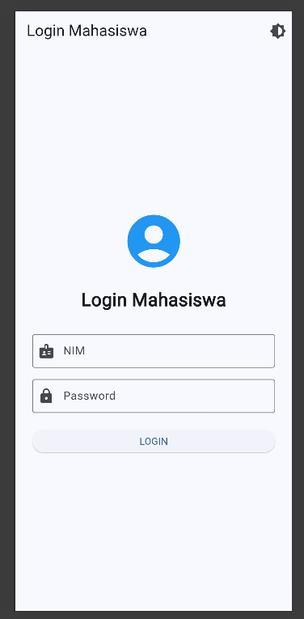
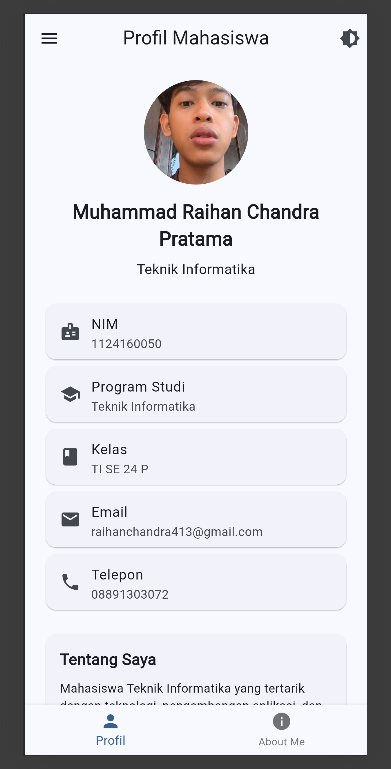
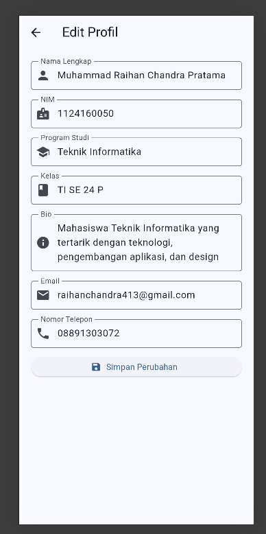
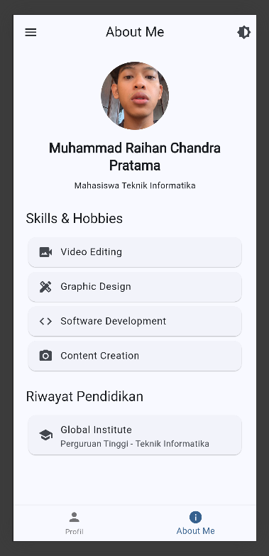

# Aplikasi Profil Mahasiswa

Aplikasi profil mahasiswa berbasis Flutter yang dibuat untuk memenuhi tugas Ujian Tengah Semester (UTS) mata kuliah Pemrograman Mobile.

## Identitas Mahasiswa

- **Nama:** Muhammad Raihan Chandra Pratama
- **NIM:** 1124160050
- **Kelas:** TI SE 24 P

## Fitur Aplikasi

1. **Login:** Form login dengan validasi input dan indikator loading.
2. **Profil Mahasiswa:** Menampilkan foto, nama, NIM, program studi, kelas, bio, email, dan nomor telepon.
3. **Edit Profil:** Mengubah informasi profil mahasiswa dengan validasi form.
4. **About Me:** Menampilkan keterampilan, hobi, dan riwayat pendidikan.
5. **Drawer Navigation:** Navigasi menuju halaman Profil, About Me, Edit Profil, dan pengaturan tema.
6. **Dark Mode:** Mengubah tampilan aplikasi ke mode terang atau gelap.
7. **App Identity:** Nama aplikasi Android adalah Profil Raihan.

## Teknologi

- Flutter
- Dart
- Material Design 3

## Screenshot Aplikasi

### Login


### Profil Mahasiswa


### Edit Profil


### About Me


## Cara Menjalankan Aplikasi

1. Clone repository:
   ```bash
   git clone https://github.com/ra1hanchandd/uts-pml-1124160050.git
   ```

2. Masuk ke folder aplikasi:
   ```bash
   cd uts-pml-1124160050/soal2-profil-app
   ```

3. Install dependencies:
   ```bash
   flutter pub get
   ```

4. Jalankan aplikasi:
   ```bash
   flutter run
   ```

## Video Demo

Link YouTube: **[Masukkan link video demo di sini]**

## Repository

[GitHub - UTS PML 1124160050](https://github.com/ra1hanchandd/uts-pml-1124160050)